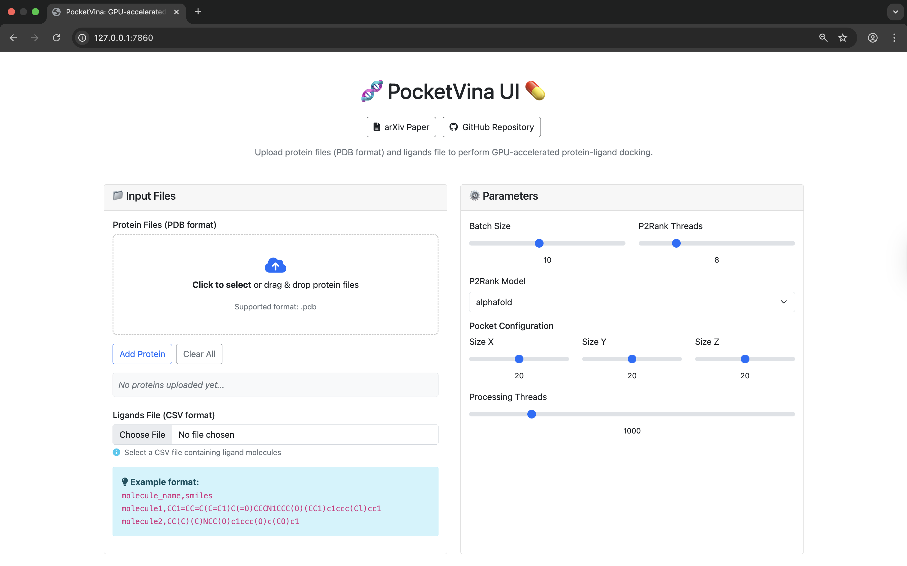

## PocketVina UI App


<p align="center">
  <a href="https://www.youtube.com/watch?v=n8-YKOTvHGs" target="_blank">
    
    <br/>
    <sub>Click the image to watch how to use PocketVina UI on YouTube</sub>
  </a>
  </p>


Run the web UI in two simple ways.

### Option A — Python (no Docker)

After completing installation in the root repo (see [`README.md`](../README.md) → Installation), activate your environment and install UI packages, then run the app from the repo root:

```bash
pip install flask pandas
python3 app/app.py
```

Open: http://127.0.0.1:7860/

### Option B — Docker (GPU)

Build from the repo root and run:

```bash
cd PocketVina
docker build --network=host -t pocketvina:v0.0.1 .
docker run --gpus all -it -p 7860:7860 pocketvina:v0.0.1 bash
python3 app/app.py
```

Or pull the prebuilt image and run:

```bash
docker pull asarigun/pocketvina:v0.0.1
docker run --gpus all -it -p 7860:7860 asarigun/pocketvina:v0.0.1 bash
python3 app/app.py
```

Open: http://127.0.0.1:7860/

### File access and shared state

Downloads and 3D previews serve only files registered by this running app process:
uploaded proteins, result CSV exports, and supported docking and visualization files
discovered inside app-created run directories. Uploads use unique, sanitized filenames;
their original names remain available for display. New file-producing code must register
its artifacts explicitly before a serving route can return them.

The registry is kept in memory. Restarting the process loses access to previous files
through these routes. Clearing proteins removes their upload registrations. Clients
share the app's uploads, runs, and registry; this app does not provide accounts or
per-user isolation.

### Rendering and regression checks

Upload names and viewer error details are rendered as text. Result tables escape
headers, cell values, and attributes on the server; preview controls carry encoded
local URLs in data attributes, with click listeners opening the Mol* overlay. Keep
this boundary when adding new display values or file previews.

Run the Flask regressions with `python -m pytest tests/test_app.py -q` and the DOM
contracts with `node --test tests/app_dom.test.cjs` (Node.js 18 or later; no npm
install). The Node tests execute the real inline application script against a minimal
DOM double. They check text and event contracts, not full browser or Mol* behavior.
CI also passes the two-client Flask upload response into these DOM checks.


